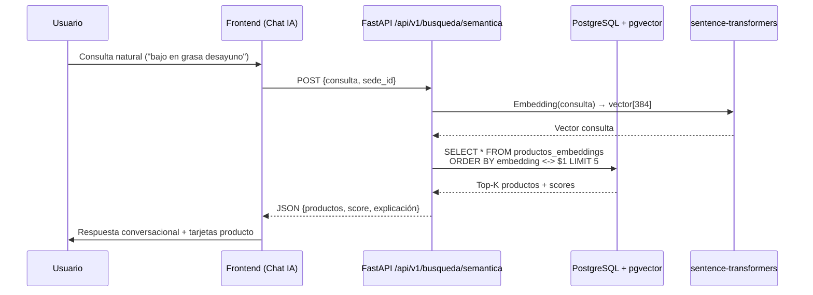

# La Economía Aya — E-Commerce Neo-Pop Brutalista

> **Tesis de Grado** — Sistema de comercio electrónico con arquitectura monolito modular, búsqueda vectorial semántica, asistente IA conversacional y cumplimiento normativo colombiano (Ley 1480/1581).

---

## 1. Título y Filosofía de Diseño

**La Economía Aya** — Supermercado & Distribuciones (Neiva, Huila)

### Neo-Pop Brutalista

La identidad visual adopta una estética **Neo-Pop Brutalista**: tipografías de alto contraste, sombras duras (offset 8px), paleta saturada (`#FFD700`, `#e30ba6`, `#fff8e7`), bordes gruesos (4px) y micro-interacciones táctiles. No es decoración: cada decisión visual reduce carga cognitiva, guía la atención a la acción principal (comprar, consultar, pagar) y refuerza la confianza del consumidor — requisito central de la **Ley 1480**.

---

## 2. Arquitectura del Sistema

```mermaid
flowchart TB
    subgraph FE[Frontend — Next.js 16 App Router]
        FE1[Catálogo & Búsqueda Semántica]
        FE2[Checkout Simulado + Ticket Neo-Pop]
        FE3[Consulta de Pedidos]
        FE4[Dashboard Admin — KPIs & Stock]
        FE5[Páginas Legales — Ley 1480/1581]
    end

    subgraph BE[Backend — FastAPI + PostgreSQL/pgvector]
        BE1[API REST v1 — Productos, Inventario, Búsqueda]
        BE2[Pipeline RAG — Embeddings sentence-transformers]
        BE3[Sincronización Siigo — Cola transacciones]
        BE4[Admin Endpoints — Analytics & Stock]
    end

    subgraph DB[(PostgreSQL 16 + pgvector)]
        DB1[(productos, categorias, sedes)]
        DB2[(pedidos, items_pedido)]
        DB3[(embeddings vectoriales 384-d)]
        DB4[(auditoria, consentimientos)]
    end

    FE1 --> BE1
    FE2 --> BE1
    FE3 --> BE1
    FE4 --> BE4
    FE5 --> BE1
    BE1 --> DB1
    BE1 --> DB2
    BE2 --> DB3
    BE3 --> DB4
    BE4 --> DB1
    BE4 --> DB2
```

### Stack Tecnológico

| Capa | Tecnología |
|------|------------|
| **Frontend** | Next.js 16 (App Router, Turbopack), React 19, TypeScript 5, Tailwind CSS 4 |
| **Backend** | FastAPI (async), SQLAlchemy 2.0, Pydantic v2, Alembic |
| **Base de Datos** | PostgreSQL 16 + `pgvector` (extensión vectorial) |
| **Embeddings** | `sentence-transformers/all-MiniLM-L6-v2` (local, 384-d) u OpenAI `text-embedding-3-small` |
| **Testing** | Playwright (E2E), Vitest (unitario) |
| **Despliegue** | Docker Compose, contenedores multi-stage |

---

## 3. Módulo de Inteligencia Artificial

### Flujo RAG (Retrieval-Augmented Generation)



### Detalles Técnicos

- **Modelo por defecto**: `sentence-transformers/all-MiniLM-L6-v2` (384 dimensiones, ~80MB, CPU-only, sin costo API)
- **Proveedor alternativo**: OpenAI `text-embedding-3-small` (configurable vía `EMBEDDING_PROVIDER=openai`)
- **Índice vectorial**: `ivfflat` con `lists = 100` para latencia < 50ms en catálogo ~10k SKUs
- **Híbrido**: Búsqueda semántica + filtro por `sede_id` + boost por disponibilidad de stock

### Asistente Conversacional

- Contexto de sistema inyectado: política de devoluciones, horarios, sedes, tono de marca Neo-Pop
- **Consentimiento previo obligatorio (Ley 1581)**: Checkbox Habeas Data antes de activar el chat
- Historial de sesión en `localStorage` (no persiste en servidor)

---

## 4. Marco Legal y Cumplimiento Normativo (Colombia)

### 4.1 Ley 1480 de 2011 — Estatuto del Consumidor

**Implementación en el Ticket de Compra Neo-Pop** (`/checkout/success/[id]`):

| Artículo | Requisito | Implementación |
|----------|-----------|----------------|
| Art. 47 | Derecho de retracto (5 días hábiles) | Banner prominente magenta `#e30ba6` con texto legal exacto |
| Art. 35 | Información clara y suficiente | Desglose: producto, cantidad, precio unitario, subtotal, IVA, total |
| Art. 22 | Identificación del proveedor | Razón social, NIT, dirección física, canales de atención |
| Art. 37 | Garantía legal | Nota al pie: "Garantía legal según Ley 1480 Art. 27-31" |

**Captura del Ticket Neo-Pop:**
```
┌─────────────────────────────────────────────────────────────┐
│  LA ECONOMÍA AYA          ✓  PAGO EXITOSO                   │
├─────────────────────────────────────────────────────────────┤
│  Pedido: ORD-20261022-A1B2    Ticket: PAY-20261022-X9Y8     │
├─────────────────────────────────────────────────────────────┤
│  Arroz Diana 1kg          2 × $4,500      $9,000           │
│  Leche Alquería 1L        1 × $5,200      $5,200           │
│  ────────────────────────────────────────────────────────  │
│  Subtotal                                          $14,200 │
│  IVA (19%)                                          $2,698 │
│  TOTAL                                           $16,898   │
├─────────────────────────────────────────────────────────────┤
│  ⚠ DERECHO DE RETRACTO (Ley 1480 Art. 47)                 │
│  Tienes 5 días hábiles tras la entrega para retractarte    │
│  sin justa causa. Contacto: WhatsApp +57 3XX XXX XXXX    │
└─────────────────────────────────────────────────────────────┘
```

### 4.2 Ley 1581 de 2011 — Habeas Data (Protección de Datos Personales)

**Implementación en Asistente IA:**

1. **Consentimiento expreso, previo e informado** — Checkbox obligatorio *antes* de renderizar el componente de chat
2. **Finalidad específica** — "Procesar consultas en lenguaje natural sobre catálogo y pedidos"
3. **Derechos ARCO** — Enlace a `/privacidad` con formulario de ejercicio de derechos (Acceso, Rectificación, Cancelación, Oposición)
4. **No transferencia internacional** — Embeddings generados localmente (sentence-transformers) por defecto
5. **Retención** — Historial de chat solo en `localStorage` del navegador (máx. 30 días, auto-limpieza)

```tsx
// Componente ConsentimientoHabeasData (simplificado)
<fieldset className="border-4 border-black bg-white p-4">
  <legend className="font-black text-sm">Consentimiento Ley 1581</legend>
  <label className="flex items-start gap-3 cursor-pointer">
    <input type="checkbox" required className="mt-1 w-5 h-5 border-2 border-black" />
    <span className="text-sm">
      Autorizo el tratamiento de mis consultas para el Asistente IA.
      <a href="/privacidad" className="underline">Política de privacidad</a>
    </span>
  </label>
</fieldset>
```

---

## 5. Guía de Despliegue Local y Docker

### 5.1 Prerrequisitos

- Docker Desktop ≥ 4.30 (WSL2 backend en Windows)
- Node.js 20+ (para `npm run build` local)
- Python 3.11+ (para scripts de ingesta / migraciones)

### 5.2 Levantar Entorno Completo

```bash
# 1. Clonar y posicionarse
git clone https://github.com/brayanaya/la_economia_app.git
cd la_economia_app

# 2. Variables de entorno
cp .env.example .env
# Editar .env si se requiere OpenAI: EMBEDDING_PROVIDER=openai

# 3. Levantar stack (PostgreSQL + pgvector + Backend API)
docker compose up -d --build

# 4. Verificar servicios
docker compose ps
docker compose logs -f api
```

**Servicios expuestos:**
- Frontend (Next.js dev): http://localhost:3000
- Backend API (FastAPI): http://localhost:8000
- Swagger UI: http://localhost:8000/docs
- PostgreSQL: `localhost:5432` (user: `postgres`, pass: `postgres`, db: `la_economia`)

### 5.3 Migraciones con Alembic

```bash
# Opción A: Dentro del contenedor de la API (recomendado)
docker compose exec api alembic upgrade head

# Opción B: Entorno local Python (requiere .venv activo)
cd la_economia_app
python -m venv .venv
source .venv/bin/activate  # Windows: .venv\Scripts\Activate.ps1
pip install -r requirements.txt
alembic upgrade head
```

> **Nota**: Si la BD ya fue inicializada por `db/init.sql` (primer `docker compose up`), usar:
> ```bash
> alembic stamp 0001
> ```
> Para marcar la migración base como aplicada sin re-ejecutar DDL.

### 5.4 Poblar Embeddings (Pipeline RAG)

```bash
# Dentro del contenedor API
docker compose exec api python -m app.scripts_ingesta_catalogo

# O local con .venv activo
python -m app.scripts_ingesta_catalogo
```

### 5.5 Build de Producción Frontend

```bash
cd frontend
npm ci
npm run build          # Verifica TypeScript + SSR
npm run start          # Sirve build de producción en :3000
```

### 5.6 Tests E2E (Playwright)

```bash
cd frontend
npx playwright install --with-deps chromium
npx playwright test
```

---

## 6. Estructura del Proyecto (Monorepo)

```text
la_economia_app/
├── app/                          # Backend FastAPI
│   ├── api/v1/
│   │   ├── endpoints/
│   │   │   ├── productos.py      # CRUD catálogo + stock multisede
│   │   │   ├── inventario.py     # Sincronización Siigo (cola)
│   │   │   ├── busqueda.py       # Retriever semántico pgvector
│   │   │   └── admin.py          # Analytics KPIs + control stock
│   │   └── router.py
│   ├── core/
│   │   ├── config.py             # Settings Pydantic v2
│   │   └── database.py           # Engine async + sessionmaker
│   ├── models/                   # SQLAlchemy 2.0 (ORM)
│   ├── schemas/                  # Pydantic v2 (request/response)
│   ├── services/
│   │   └── embeddings.py         # Proveedor ST / OpenAI
│   ├── scripts_ingesta_catalogo.py
│   └── main.py
├── alembic/                      # Migraciones DB
├── db/
│   ├── init.sql                  # Esquema base (Docker entrypoint)
│   └── seed.sql                  # Datos demo (productos, sedes)
├── frontend/                     # Next.js 16 App Router
│   ├── src/
│   │   ├── app/                  # Rutas (App Router)
│   │   │   ├── checkout/         # Flujo pago + ticket Neo-Pop
│   │   │   ├── pedidos/          # Consulta por número
│   │   │   ├── admin/            # Dashboard KPIs + stock
│   │   │   └── [legal]/          # cookies, privacidad, terminos, pqr
│   │   ├── components/           # UI Neo-Pop (Button, Card, Badge...)
│   │   ├── context/              # CarritoContext (localStorage)
│   │   └── lib/                  # API client (fetch wrapper)
│   ├── tests/                    # Playwright E2E
│   └── package.json
├── docker-compose.yml
├── Dockerfile
├── Dockerfile.frontend
├── requirements.txt
├── .env.example
└── README.md
```

---

## 7. Verificación de Calidad (Quality Gates)

| Check | Comando | Estado Esperado |
|-------|---------|-----------------|
| **TypeScript + Build** | `cd frontend && npm run build` | ✅ Sin errores |
| **Lint** | `cd frontend && npm run lint` | ✅ 0 warnings |
| **Tests E2E** | `cd frontend && npx playwright test` | ✅ 8/8 passed |
| **Backend Syntax** | `docker compose exec api python -m py_compile app/main.py` | ✅ OK |
| **Alembic History** | `docker compose exec api alembic history` | ✅ Lineal |

---

## 8. Referencias Normativas

- **Ley 1480 de 2011** — Estatuto del Consumidor (Derecho de retracto, información, garantías)
- **Ley 1581 de 2011** — Régimen General de Protección de Datos Personales (Habeas Data)
- **Decreto 1377 de 2013** — Reglamentación parcial Ley 1581 (medidas de seguridad)
- **Sentencia C-1011 de 2008** — Corte Constitucional: consentimiento previo, expreso e informado

---

## 9. Licencia y Autoría

**Autor**: Brayan Aya — Ingeniería de Sistemas, Universidad Surcolombiana
**Tesis**: *Diseño e Implementación de una Plataforma de Comercio Electrónico con Búsqueda Semántica y Cumplimiento Normativo para PyMEs del Sector Alimentario en el Huila*
**Año**: 2026

> Este proyecto es código abierto con fines académicos. El uso comercial requiere autorización expresa.